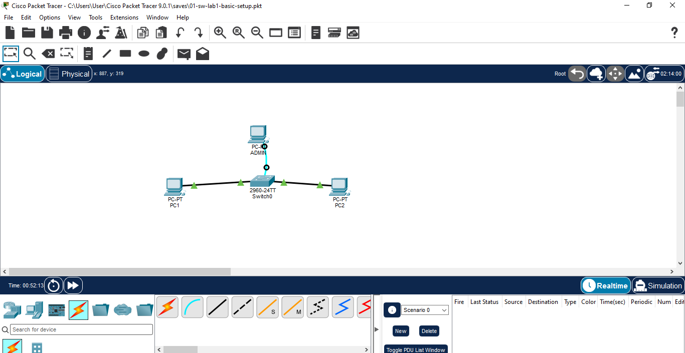

# Lab 01: Basic Cisco Switch Setup (SW-LAB1)

## 🎯 Goal
Configure a Cisco 2960 switch from scratch through the console port and verify
how a switch learns MAC addresses.

## 🗺️ Topology


| Device | Connection | IP Address |
|---|---|---|
| PC-ADMIN | Console (RS-232 → Console port) | n/a |
| PC1 | Fa0/1 (copper straight-through) | 192.168.10.1 /24 |
| PC2 | Fa0/2 (copper straight-through) | 192.168.10.2 /24 |
| SW-LAB1 | Cisco 2960 switch | n/a |

## ⚙️ Configuration
```
hostname SW-LAB1
no ip domain-lookup
banner motd # Authorized access only #
enable password Admin1
enable secret Cisco123
line console 0
 password Console1
 login
service password-encryption
copy running-config startup-config
```

## ✅ Verification
| Command | What it showed |
|---|---|
| `show running-config` | Passwords in plain text before encryption; Type 7 after `service password-encryption` |
| `show startup-config` | Empty before saving; full config after `copy running-config startup-config` |
| `show mac address-table` | PC1 and PC2 MAC addresses learned as DYNAMIC on Fa0/1 and Fa0/2 after a ping |

## 💡 What I learned
- `enable secret` overrides `enable password`. Only the secret worked to enter privileged EXEC mode.
- `password` on a line does nothing without `login`.
- `service password-encryption` hides plain-text passwords with weak Type 7 encryption.
- All changes go to the running-config in RAM and are lost on reboot unless saved to the startup-config in NVRAM.
- A switch learns MAC addresses from the **source** address of incoming frames and stores them as DYNAMIC entries that age out after 5 minutes.
- `no ip domain-lookup` stops the switch from trying to resolve mistyped commands as hostnames.

## 📁 Files
- `01-sw-lab1-basic-setup.pkt`: Packet Tracer file
- `sw-lab1-config.txt`: full running configuration
- Screenshots of the topology, encrypted passwords and MAC table

> ⚠️ Passwords in this lab are for practice only. Never publish real device passwords.
